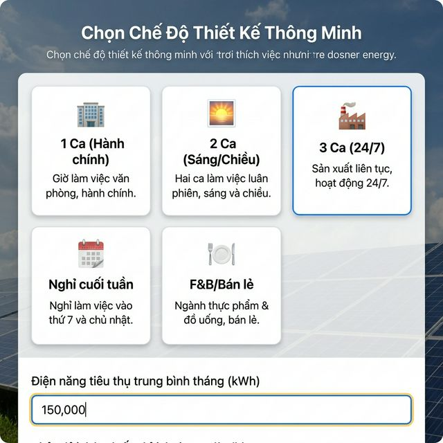
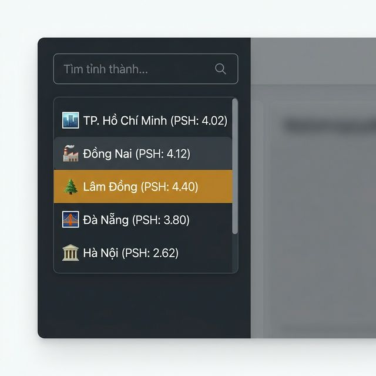
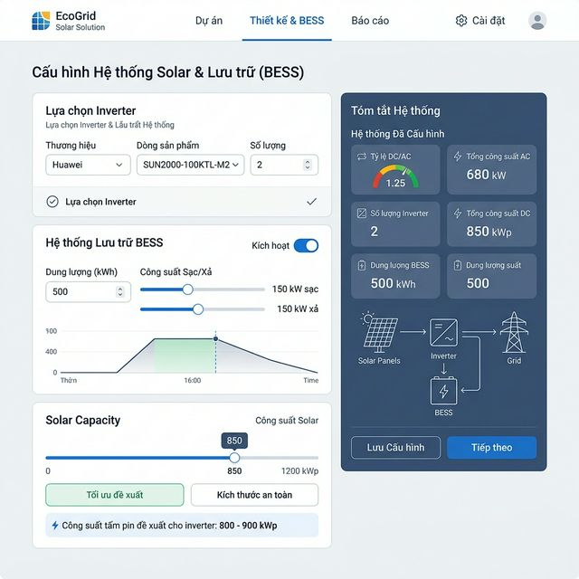
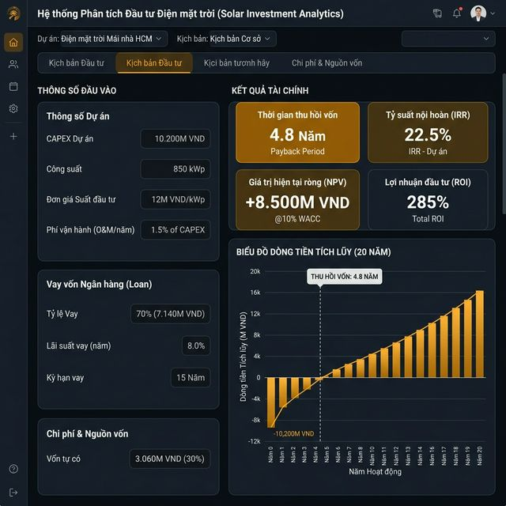
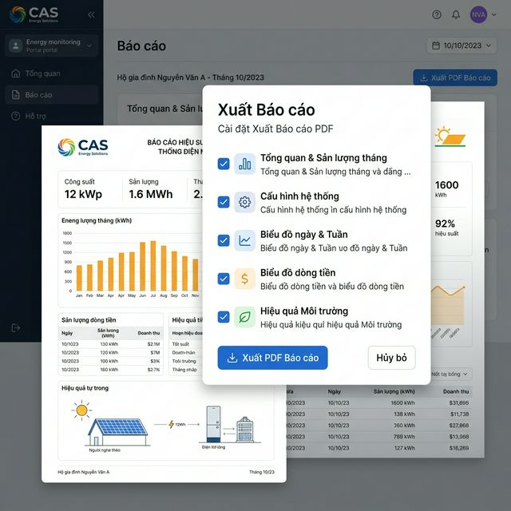

# 📘 CẨM NANG SỬ DỤNG SOLAR OPTIMIZER (DÀN CHO SALE)

Chào mừng bạn đến với công cụ tính toán năng lượng mặt trời chuyên nghiệp. Cẩm nang này giúp bạn làm chủ 5 tính năng quan trọng nhất để tư vấn khách hàng "chuẩn không cần chỉnh".

---

## 1. PHÂN TÍCH PHỤ TẢI & SMART DESIGN
*Đây là bước "khám bệnh" cho ngôi nhà/nhà máy của khách hàng.*

### Cách dùng:
*   **Nếu có file Excel:** Nhấn **"Upload Load Profile"** để hệ thống đọc dữ liệu thực.
*   **Nếu chưa có file:** Dùng **Smart Design**. 
    *   Chọn loại hình (Ví dụ: "Nhà máy 2 ca").
    *   Nhập số điện trung bình tháng (kWh) từ hóa đơn.

### Giải thích cho khách hàng:
> *"Dựa trên loại hình sản xuất của anh/chị, phần mềm của em giả lập biểu đồ dùng điện 24/7 để biết lúc nào anh chị dùng nhiều điện nhất (giờ cao điểm) để lắp pin cho hiệu quả."*

---

## 2. CHỌN TỈNH THÀNH & GIỜ NẮNG (PSH)
*Vì nắng ở TP.HCM khác nắng ở Hà Nội.*

### Cách dùng:
*   Chọn đúng tỉnh thành nơi lắp đặt trong danh sách.
*   Hệ thống tự điền số **PSH (Peak Sun Hours)** - tức là số giờ nắng "vàng" mỗi ngày.

### Giải thích cho khách hàng:
> *"Miền Nam mình có khoảng 4.4 giờ nắng đỉnh mỗi ngày, nên 1kWp pin mặt trời sẽ tạo ra khoảng 4.4kWh điện. Em chọn đúng khu vực để con số tính toán ra tiền là chính xác nhất cho anh/chị."*

---

## 3. THIẾT KẾ "1-CLICK" (OPTIMAL & SAFE FIT)
*Tự động chọn kích thước hệ thống phù hợp nhất.*

### Cách dùng:
*   **Nút Optimised:** Hệ thống tự chọn công suất để anh/chị thu hồi vốn nhanh nhất.
*   **Nút Safe Fit (Zero-Export):** Dành cho khách hàng sợ dư nhiều điện mà không bán được. Hệ thống sẽ bóp nhỏ lại để vừa đủ dùng.

### Giải thích cho khách hàng:
> *"Em dùng AI để tối ưu: Một là lắp để nhanh lấy lại vốn nhất (Optimised), hai là lắp vừa khít với nhu cầu dùng điện của anh chị để không lãng phí điện (Safe Fit)."*

---

## 4. CHỈ SỐ TÀI CHÍNH (PAYBACK, IRR)
*Đưa ra con số thuyết phục túi tiền khách hàng.*

### Các chỉ số cần nhớ:
*   **Payback (Hoàn vốn):** Sau bao nhiêu năm thì khách hàng "hòa vốn". (Dưới 5 năm là cực tốt).
*   **IRR (Lãi suất):** Tương đương lãi suất ngân hàng nếu khách hàng đem tiền đó đi gửi. (Trên 15% là rất hấp dẫn).
*   **Tiết kiệm năm 1:** Con số tiền mặt khách hàng sẽ giữ lại được ngay trong năm đầu.

### Giải thích cho khách hàng:
> *"Dự án này hoàn vốn chỉ sau 4.5 năm. Từ năm thứ 5 trở đi, mỗi năm anh chị 'bỏ túi' thêm 200 triệu tiền điện tiết kiệm được, coi như là lợi nhuận ròng."*

---

## 5. XUẤT BÁO CÁO GỬI KHÁCH HÀNG
*Chốt deal chuyên nghiệp.*

### Cách dùng:
*   Vào tab **Report**.
*   Nhấn **"Xuất PDF Báo cáo"**.
*   File PDF sẽ có đầy đủ biểu đồ màu sắc, bảng tính tiền, và cả hiệu quả môi trường (Giảm CO2).

### Giải thích cho khách hàng:
> *"Em gửi anh/chị báo cáo chi tiết bằng PDF. Trong này có đủ biểu đồ, lộ trình tiền điện tiết kiệm trong 20 năm để anh/chị trình ban giám đốc."*

---

**Mẹo nhỏ cho Sale:**
*   **Tỷ lệ tự dùng > 80%:** Khách hàng đang dùng điện mặt trời rất hiệu quả.
*   **Nếu tiết kiệm ít:** Thử tăng công suất kWp hoặc gợi ý thêm Pin lưu trữ (BESS) để dùng điện mặt trời cả ban đêm.
